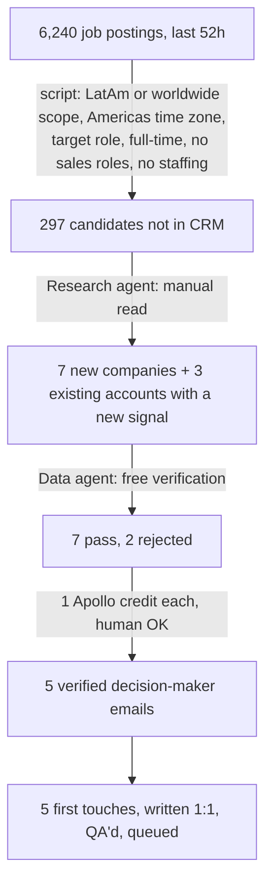

# 01 · Signal-based outbound

**Question:** Which US companies are hiring, right now, for a role a Latin American professional can do, and who decides?
**Company:** A (nearshore talent, US market) · **Run:** one morning, October 2026 · **Stack:** Himalayas API, Apollo (free search plus paid reveal), Claude Code subagents, CRM artifact.

## The funnel from one run

| Stage | Count | Cost |
|---|---|---|
| Postings scanned | 6,240 | 0 (public API) |
| Candidates after the script filter | 297 | 0 |
| Qualified by the research agent | 7 new + 3 re-engage | 0 |
| Passed free verification | 7 of 9 (2 sold outsourcing models) | 0 |
| Emails revealed | 5 | 5 credits |
| Verified emails | 5 of 5 | |

## How each gate works

1. **Signal.** The radar ([tools/radar-himalayas.js](../../tools/radar-himalayas.js)) keeps postings open to Latin America or worldwide, in Americas time zones, for target roles, and full-time only. Priority order:
   1. They are already hiring in LatAm.
   2. They already have remote people outside the US.
   3. The role fits, and the question is whether they would.
2. **Dedupe.** Every company is checked against the CRM (420 accounts) and HubSpot first. Existing accounts with a new posting are not discarded: they move up as a reason for the next touch.
3. **Free verification.** One people search per company, with a 1–200 employee filter and founder or C-level seniority. That confirms size and the decision maker without spending anything. Staffing, EOR and outsourcing firms are competitors and get rejected.
4. **Waterfall enrichment.** Company website, then team page, then patterns from public commits, then Apollo. A credit is spent only when the Apollo person matches the company's domain and headquarters.
5. **Human gate.** The manager asks before every reveal. That day: "OK for 5 credits? You'd have 26 left."

## Same day, a channel that didn't work

A LinkedIn job search ("Full Stack, United States, Remote, last 24h"): 25 postings, **0 new qualified accounts**.

| Why it dropped | Count |
|---|---|
| Large companies | 10 |
| Staffing or IT consultancies | 7 |
| EOR (direct competitor) | 1 |
| Over 200 employees | 3 |
| Couldn't identify the company | 2 |
| Already in the CRM | 1 |

"US (Remote)" postings almost always require US work authorization, so that search was demoted. Searches that say "Latin America" or "worldwide" stayed.

## What this proves, and what it doesn't

- **It proves** the system can cut thousands of postings down to a handful of verified decision makers, for about one credit per contact. Across the month, it put about 500 one-to-one emails in front of decision makers with ~1.2% bounces. Two of them got into pricing conversations: a CSO who replied the same day, and an HR manager the Head of Ops referred me to.
- **It doesn't prove** that the signal turns into meetings. Booked meetings are still at 0. The bottleneck turned out to be the message, not the targeting (see [case 02](../02-copy-qa-without-templates/)).
