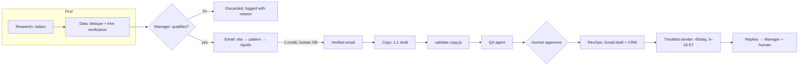

# Architecture

## The team

One human (me) approves, sends and owns every process. A manager agent coordinates five specialists. Each specialist is a Claude Code subagent with its own spec ([agents/](../agents/)), and each one runs on the cheapest model that does the job well.

| Agent | Role | Model | Can write to |
|---|---|---|---|
| Manager | Runs the daily order, routes work, decides what qualifies, asks the human for approvals | Opus | Everything, after approval |
| Research | Signal radars (job boards, LinkedIn posts the human pastes, funding rounds) | Sonnet | Nothing (reports only) |
| Data | Dedupe against the CRM, free verification, free email discovery | Haiku | Nothing (reports only) |
| Copy | Writes first touches, follow-ups, nurture and DMs in the owner's voice | Opus | Draft files |
| QA | Checks copy against voice, offer and hard rules; fixes minor issues; escalates the rest | Sonnet | Draft files |
| RevOps | CRM records, Gmail drafts, logs, weekly report | Haiku | CRM, Gmail drafts |

Read-only agents can't cause damage. Every irreversible action has one place where it happens and a gate in front of it:
- spending a credit;
- creating a draft, which the throttled sender will send;
- posting.

## Daily flow

The order of the day is fixed:
1. Web radar.
2. LinkedIn.
3. Enrichment.
4. CRM reactivation.
5. Follow-ups.
6. All drafts at once.
7. Close of day (bounces, lessons learned, voice review).

## Office dashboard

Agents report their state to a shared database behind a live dashboard: working, waiting, blocked on the human, or done. They also report handoffs ("Research → Data: 9 companies to verify") and deliveries that need approval.

The human approves, requests changes or discards from an inbox on the same page. Each process also has a "Functions" panel, so anyone can see who does what.

## CRM

The CRM is a document collection in a Claude artifact. Each account carries:
- stage;
- source, and the signal with its evidence URL;
- angle and priority;
- the email touches and a full history;
- the next action and its date;
- nurture state.

Every lead keeps where it came from and why it qualified. That is how the funnel can be measured by source.

## Two deployments, one design

Company B runs the same architecture with its own data, voice and rules. Nothing is shared between the two except the design. One adaptation: Company B's emails are sent by hand from its own domain, because the Gmail connector belongs to Company A.
