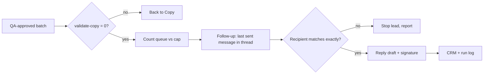

# SOP P17: Gmail drafts (approved touches → send queue)

| Field | Value |
|---|---|
| ID | P17 |
| Area | Outreach |
| Version | v2 (2026-10-28, after the incident in case 05) |
| Owner | Harold (Head of Sales) |
| Executor | RevOps agent |
| Maturity | SOP |
| Automation | **A0 assisted** (demoted from A1 on 2026-10-28; back to A1 after 3 clean runs) |
| Runs in | Claude Code session, Gmail connector |
| Review | every 7 days |
| Irreversible actions | Creating a draft. While the throttled sender is on, **a draft is a scheduled send** |
| Personal data | Yes: recipient emails (they live in the CRM and Gmail, never in files) |

## When to use
Step 6 of the daily order, once QA has approved the day's batch. Only touches that send today. Never pre-load future days.

## Inputs
- Batch files approved by QA (`## T<n> | company | email | subject` blocks). Never the `-v1` originals.
- The CRM record of each lead.

## Preconditions
- Gmail connector available. If it isn't, stop.
- `validate-copy.js` exits 0 on the batch.
- Queue count (`list_drafts`) + already sent today ≤ daily cap. Whatever is over the cap rolls to tomorrow automatically.

## Steps
| # | Step | Who | Output |
|---|---|---|---|
| 1 | Count the queue and today's sends against the cap | RevOps | Number of free slots |
| 2 | For each follow-up: find the thread, get the **last sent message** and its `to` | RevOps | Message ID + recipient |
| 3 | **Recipient check:** the `to` must match the thread's recipient character for character. If it doesn't match the CRM, use the thread's (the one that delivered) and flag the CRM | RevOps | Verified recipient |
| 4 | Create the draft as a reply to that message, with the approved signature and no sign-off | RevOps | Draft |
| 5 | First touches: create a new draft with the batch subject | RevOps | Draft |
| 6 | Order: follow-ups due today first, new first touches last | RevOps | Queue |
| 7 | Update the CRM: touch logged, next date (+3 business days for T1/T2; nurture +30 for T3) | RevOps | CRM |
| 8 | Report: drafts by file, skipped (with reason), final queue size | RevOps | Report to Manager |

## Gates
- Any recipient mismatch, or any lead whose email or name is marked "unverified": **stop that lead and report it.** Do not pick one.

## Prohibitions
- **Never edit a draft in place.** Delete it and recreate it. Why: the connector's update isn't reliable (October 2026).
- **Never infer a recipient.** Why: 8 follow-ups went to dotless addresses and 2 bounced (case 05).
- **Never use the old signature with the domain link.** Why: it got the mailbox into spam (case 03).
- **No days or dates in the body.** Why: the queue can send a day late.

## Outputs
Drafts in Gmail, CRM updated, one run-log row.

## Known deviations
| Date | What happened | Fix | Test case |
|---|---|---|---|
| 2026-10-28 | 8 replies addressed to `firstnamelastname@` instead of `firstname.lastname@`; 2 bounced | Step 3 added; 6 drafts recreated | TC-1 |

## Test cases
| Input | Expected | Must not happen |
|---|---|---|
| TC-1: thread sent to `ana.diaz@acme.example.com`, CRM has `anadiaz@acme.example.com` | Reply to `ana.diaz@...`, CRM flagged | A draft to `anadiaz@...` |
| TC-2: lead marked "email unverified" | Skipped and reported | A draft created |
| TC-3: queue 40 + sent today 10, cap 45 | All drafts created; report says 5 roll to tomorrow | Drafts dated for future days |

## Diagram

